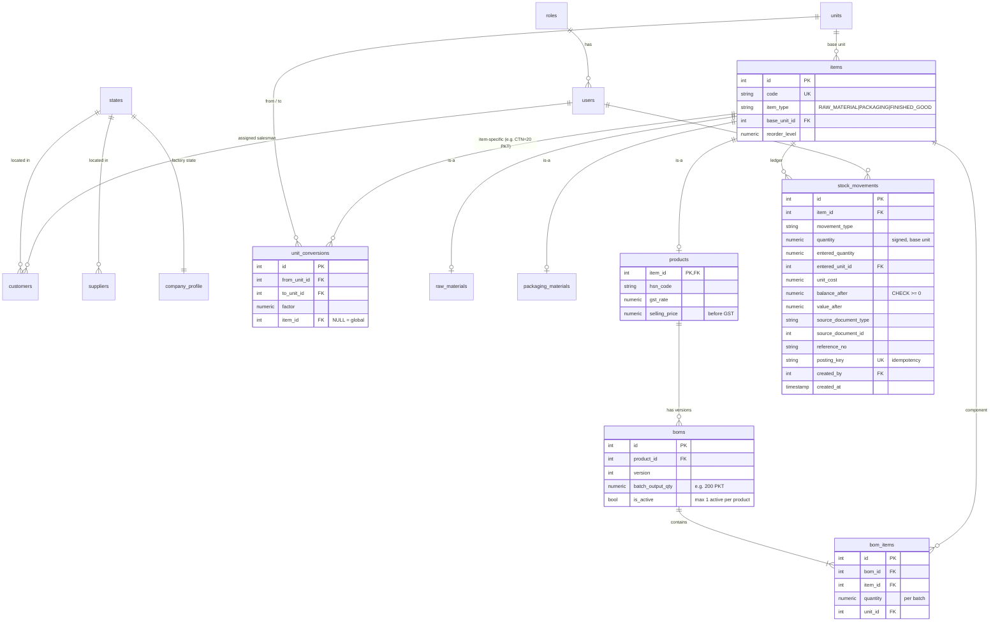
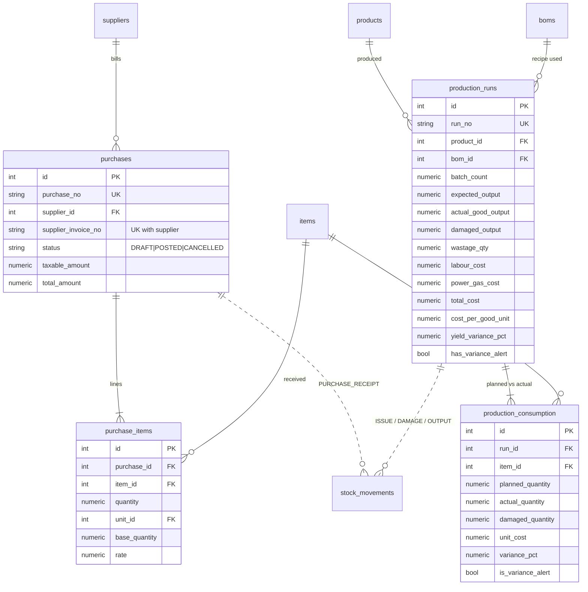
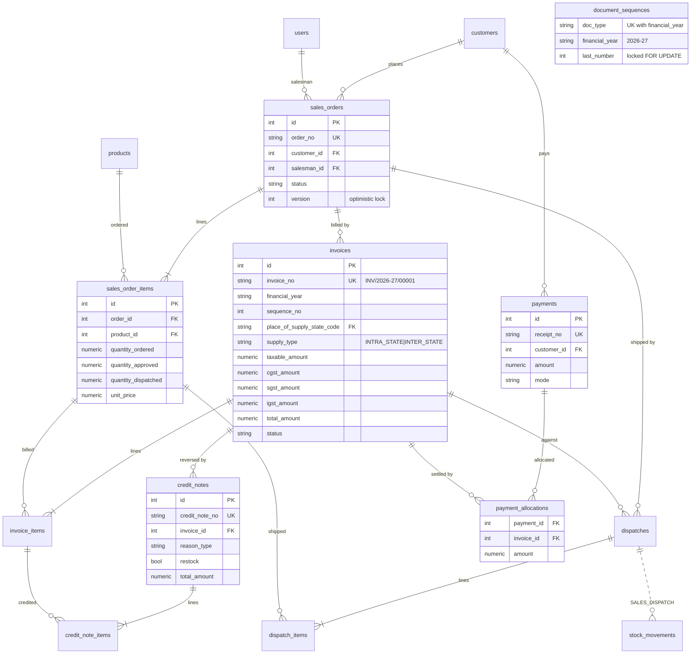

# Database Schema & ER Diagram

32 tables, PostgreSQL target. Source of truth: `backend/app/models/*.py`;
migration: `backend/alembic/versions/0001_initial_schema.py`.

## ER diagram

The diagram is split into three views so each stays readable. GitHub renders Mermaid natively.

### A. Masters, BOM and inventory

### B. Purchasing and production

### C. Sales, billing and receivables

Cross-cutting tables not drawn above: `audit_logs` (user, entity, before/after
JSON), `app_settings` (e.g. `variance_tolerance_pct = 3`), `company_profile`
(single row: GSTIN, state 33).

Dotted lines (`..`) to `stock_movements` are **logical** links via
`source_document_type` + `source_document_id`. They are not foreign keys,
because one ledger row can come from any of several document tables.

## Constraints the database enforces

| Rule | Mechanism |
|---|---|
| No negative stock | `CHECK (balance_after >= 0)` on `stock_movements`, plus an item row lock when posting |
| Quantity sign matches movement type | `CHECK` listing inbound/outbound types |
| No duplicate stock postings | `UNIQUE (posting_key)` |
| Ledger history is immutable | PostgreSQL trigger blocks `UPDATE`/`DELETE` on `stock_movements` |
| One active BOM per product | partial unique index `WHERE is_active` |
| BOM / consumption never contain finished goods | `CHECK component_type IN (RAW_MATERIAL, PACKAGING)` |
| CGST+SGST xor IGST | `CHECK` on `invoices.supply_type` vs tax columns |
| Totals add up | `CHECK total = taxable + taxes (+ round_off)` on invoices, invoice lines, credit notes, purchases |
| Gap-free invoice numbers per FY | `UNIQUE (financial_year, sequence_no)` + locked `document_sequences` row |
| Same supplier bill entered once | `UNIQUE (supplier_id, supplier_invoice_no)` |
| A posted production run has its output | `CHECK status <> 'POSTED' OR actual_good_output IS NOT NULL` |
| Global vs item-specific conversions unique | two partial unique indexes on `unit_conversions` |
| Positive quantities/amounts | `CHECK` on every line table |

Enums are stored as `VARCHAR` + `CHECK` (not native PG enums), so adding a
value is a simple migration.

## Precision

| Kind | Type |
|---|---|
| Money | `NUMERIC(14,2)` |
| Quantity | `NUMERIC(16,4)` |
| Unit cost / factor | `NUMERIC(18,6)` |
| Percent | `NUMERIC(9,4)` |

## Modelling choices worth explaining

1. **`items` supertype.** One FK target for the ledger, BOM and purchases,
   with no polymorphic nullable columns. `products.item_id` is both PK and FK.
2. **`balance_after` on each movement.** It turns "no negative stock" into a
   database rule, and it makes the stock card / ledger report a simple ordered
   read. The current balance is the latest row per item, and that always
   equals `SUM(quantity)` (an invariant the tests check).
3. **Invoice snapshots.** Customer name, GSTIN, address and place of supply
   are copied onto the invoice, because a legal document must not change
   when the customer master is edited later.
4. **`quantity_approved` vs `quantity_ordered`.** The admin's change is kept
   next to the salesman's original, and an `audit_logs` row records who
   changed it and why.
5. **Payment allocations.** These let ageing be computed per invoice, while a
   receipt can still sit partly unallocated as an advance.
